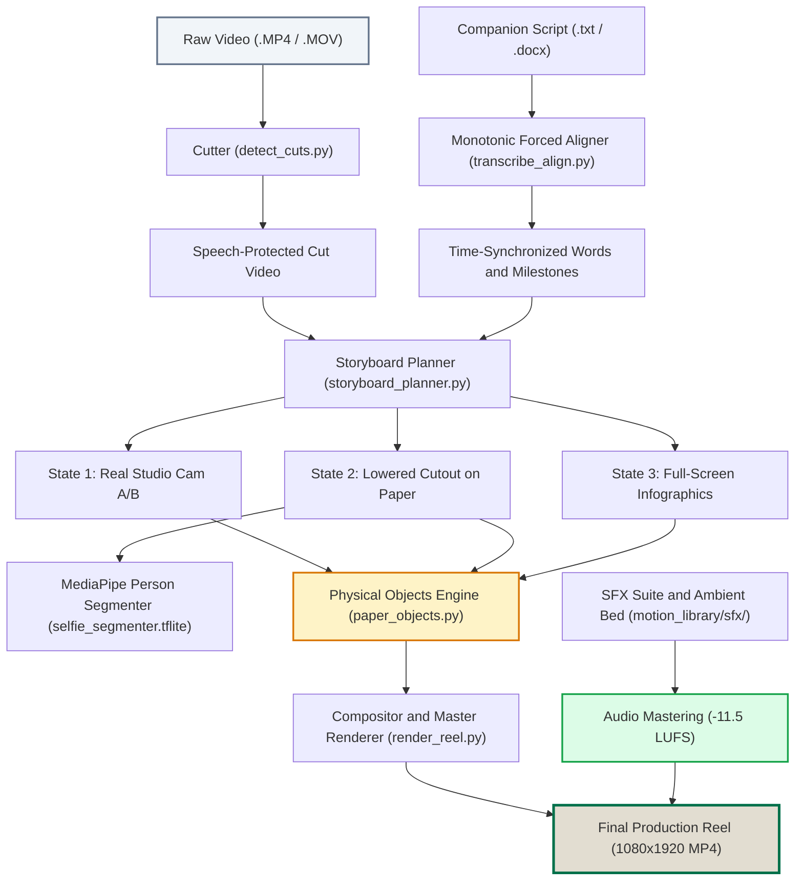

<div align="center">

# edit-reel
### Autonomous AI Video Editor for Instagram Reels and TikTok
**Signature Tactile "Paper and Objects" Editorial Aesthetic for Agentic AI**

[](https://github.com/MMhaidra/edit-reel/releases/latest)
[](https://github.com/MMhaidra/edit-reel#packages)
[](https://opensource.org/licenses/MIT)
[](https://www.python.org/downloads/)
[](https://developers.google.com/mediapipe)
[](https://ffmpeg.org/)
[](https://github.com/MMhaidra/edit-reel)
[](https://claude.ai)
[](https://cursor.com)

<p align="center">
  <a href="#quickstart-30-seconds">Quickstart</a> |
  <a href="#releases">Releases</a> |
  <a href="#packages">Packages</a> |
  <a href="#the-signature-paper-and-objects-aesthetic">Aesthetic Engine</a> |
  <a href="#multilingual-support">Multilingual Support</a> |
  <a href="#universal-scene-blueprint">Scene Blueprint</a> |
  <a href="#agentic-ide-integrations">Agentic Integrations</a> |
  <a href="#audio-mastering-suite">Audio Suite</a>
</p>

---

</div>

<p align="center">
  
</p>

## Overview

edit-reel is an autonomous, zero-interaction editorial pipeline that transforms raw talking-head recordings into production-grade 9:16 vertical reels for Instagram and TikTok.

Engineered for educational, scientific, technical, macroeconomic, and business creators, edit-reel replaces generic AI video templates with a physical-object editorial aesthetic:
- Tactile warm paper canvas (`#E2DDD1`) with subtle natural texture.
- Hanging cream price tags with brass eyelets and physics-based pendulum sway.
- Animated odometer counters for numerical milestones and financial figures.
- 3D coin stacks and dimensional trend arrows.
- Academic notebook paper cutoffs (ruled lines, red margins, torn edge, Scotch tape) for empirical and journal citations.
- Parallel comparative coordinate plots (such as Linear Myth vs. Logarithmic Reality).
- -11.5 LUFS vocal mastering chain with spectral noise reduction, ambient bed ducking, and motion-locked sound effects.

---

## Releases

The latest official release is available on GitHub:

- **Current Stable Version**: [v1.0.0](https://github.com/MMhaidra/edit-reel/releases/tag/v1.0.0)
- **Source Archives**:
  - [Download tar.gz](https://github.com/MMhaidra/edit-reel/archive/refs/tags/v1.0.0.tar.gz)
  - [Download zip](https://github.com/MMhaidra/edit-reel/archive/refs/tags/v1.0.0.zip)

To download and extract the release archive:
```bash
curl -fsSL https://github.com/MMhaidra/edit-reel/archive/refs/tags/v1.0.0.tar.gz | tar -xz
cd edit-reel-1.0.0
```

---

## Packages

You can install edit-reel directly into any Python 3.9+ environment or agentic IDE workspace using standard package managers.

### 1. Direct Install via pip (GitHub)

```bash
pip install git+https://github.com/MMhaidra/edit-reel.git
```

### 2. Editable Developer Install

```bash
git clone https://github.com/MMhaidra/edit-reel.git
cd edit-reel
pip install -e .
```

### 3. One-Line Agentic Skill Installer

For automatic configuration across Google Antigravity, Claude Code, and Cursor:
```bash
curl -fsSL https://raw.githubusercontent.com/MMhaidra/edit-reel/main/install.sh | bash
```

---

## Universal Scene Blueprint

The renderer utilizes a structured 8-scene editorial rhythm that maintains high visual retention throughout 45-to-90 second reels. This structure applies across all domains (technology, science, economics, philosophy, education, business):

| Scene | Editorial Function | Visual State | Graphic Primitives | Audio Milestone |
|:---:|:---|:---:|:---|:---:|
| **1** | Core Hook / Problem Statement | Real Camera Studio | Direct address with subtle 1.04x punch-in | Clean voice, ambient bed starts |
| **2** | Critical Number / Pivot Metric | Lowered Cutout on Paper | Hanging cream tag with rolling odometer | Clean pop, cash chime SFX |
| **3** | Acceleration / Upward Trajectory | Lowered Cutout on Paper | 3D coin stack, dimensional directional arrow | Paper turn SFX |
| **4** | Comparative Breakdown (Myth vs. Reality) | Full-Screen Infographic | Dual parallel coordinate plots | Subtle whoosh SFX |
| **5** | Empirical Evidence / Study Citation | Lowered Cutout on Paper | Ruled notebook cutoff slip with Scotch tape | Tech tick SFX |
| **6** | Global Context / Geographic Distribution | Full-Screen Infographic | Circular entity badges and distribution ranks | Subtle whoosh SFX |
| **7** | Counter-Intuitive Truth / Metric Contrast | Lowered Cutout on Paper | Split bar comparison, contrast cards | Tech tick SFX |
| **8** | Strategic Takeaway / Actionable Framework | Lowered Cutout on Paper | Triple rounded icon chips and takeaway card | Clean pop, outro bed |

---

## Multilingual Support

edit-reel provides native speech-protected transcription, acoustic alignment, and typographic rendering across major worldwide languages:

| Language | Code | Script Type | Subtitle Typography | Ground-Truth Citation Handling |
|:---|:---:|:---:|:---|:---|
| **English** | `en` | Latin | Bold Sans-Serif (`#FFFFFF` with `#000000` shadow) | Native technical spelling and formulas |
| **Spanish** | `es` | Latin | Bold Sans-Serif | Academic titles and journal citations preserved |
| **Mandarin Chinese** | `zh` | Simplified / Traditional | PingFang SC / Noto Sans CJK | Automatic CJK character tokenization |
| **Hindi** | `hi` | Devanagari | Devanagari MT / Noto Sans Devanagari | Full conjunct ligature support |
| **Arabic** | `ar` | Arabic (RTL) | Al Bayan / Geeza Pro / Naskh | Monotonic right-to-left word-by-word highlighting |
| **French** | `fr` | Latin | Bold Sans-Serif | Accent-preserved phonetics |
| **Portuguese** | `pt` | Latin | Bold Sans-Serif | Brazilian and European Portuguese phonetics |
| **German** | `de` | Latin | Bold Sans-Serif | Compound noun protection during speech cuts |
| **Japanese** | `ja` | Kanji / Kana | Hiragino Sans / Noto Sans JP | Boundary-aware acoustic alignment |
| **Italian** | `it` | Latin | Bold Sans-Serif | Latin typographic layout |
| **Russian** | `ru` | Cyrillic | Arial Bold / Helvetica Cyrillic | Cyrillic character set support |
| **Korean** | `ko` | Hangul | AppleGothic / Noto Sans KR | Syllable-block acoustic synchronization |
| **Regional Dialects** | `ary`, `darija` | Arabic / Arabizi | Naskh / Latin | Phonetic Darija alignment with English study titles |

To run the pipeline in a specific language, specify the language flag:
```bash
python scripts/pipeline.py -i input_video.mp4 --lang es
python scripts/pipeline.py -i input_video.mp4 --lang zh
python scripts/pipeline.py -i input_video.mp4 --lang ar
```

---

## Quickstart (30 Seconds)

### Step 1: Install Dependencies
```bash
# Clone repository
git clone https://github.com/MMhaidra/edit-reel.git
cd edit-reel

# Setup Python environment
python3 -m venv .venv
source .venv/bin/activate
pip install -r requirements.txt

# Ensure FFmpeg is installed
# macOS:
brew install ffmpeg
# Ubuntu / Debian:
sudo apt-get install -y ffmpeg
```

### Step 2: Render Your First Reel
```bash
# Process a raw talking-head recording with optional companion script
python scripts/pipeline.py \
  -i ~/Desktop/projects/reels_IG/raw_sample.mp4 \
  -s ~/Desktop/projects/reels_IG/script.docx \
  -o ~/Desktop/projects/reels_IG/edited_output \
  --lang en
```

### Step 3: Generate Scene Preview Stills
```bash
python scripts/preview_reel_stills.py /tmp/reel_previews
```

---

## The Signature "Paper and Objects" Aesthetic

```text
3-STATE ALTERNATING VISUAL RHYTHM
-------------------------------------------------------------
State 1: REAL CAMERA STUDIO (Camera A/B)
  - Authentic background preserved for opening hook and pauses
  - 1.04x punch-in zooms on sentence transitions for retention

State 2: LOWERED CUTOUT SPEAKER + PHYSICAL OBJECTS
  - MediaPipe AI segmentation (selfie_segmenter.tflite)
  - Speaker positioned on warm paper canvas (y = 800..1920)
  - Upper canvas displays hanging tags, counters, and coin stacks

State 3: FULL-SCREEN INFOGRAPHIC
  - Side-by-side comparative plots (Linear vs. Logarithmic)
  - Academic notebook cutoffs with ruled lines and tape
```

### 1. Physical Objects
- **Hanging Price Tags**: Cream cards with angled corners, inner stroke border, and gold metal eyelet hanging from a string. Includes physics-based pendulum sway upon entry.
- **Dynamic Loading Numbers**: Numerical milestones animate as rolling odometer counters (e.g. $0 to $75,000 before a stamp reveal).
- **3D Coin Stacks**: Multi-tier gold coin stacks with rim bevels, accompanied by forest-green (`#00704A`) up-arrows and red (`#BA1828`) down-arrows.
- **Academic Notebook Cutoffs**: Authentic pinned notebook paper slips with faint ruled blue-gray lines (`#CBD5E1`), red vertical margin line (`#F87171`), torn bottom edge, and semi-transparent top Scotch tape. Positioned lower down (`y = 165` on speaker scenes, `y = 210` on full-screen scenes) to safely clear mobile camera cutouts and platform status bars.
- **Vector Icon Chips**: Rounded white label chips (`border-radius: 18px`) with high-resolution vector icons.

### 2. Speech-Protected Trimming and Anti-Arm-Reach Cutoff
- `detect_cuts.py` leverages Faster-Whisper with word-level timestamps to protect every valid spoken syllable.
- Automatically removes dead-air pauses, throat clears, stumbles, and repeated takes.
- **Anti-Arm-Reach Cutoff**: Trims cleanly at the calm, smiling frame following the final word, eliminating the motion of the speaker reaching forward to turn off the camera.

---

## Audio Mastering Suite

Every video rendered by edit-reel passes through an automated broadcast audio mastering chain:

```text
Raw Microphone Audio
        |
        v
FFT Spectral Denoiser (afftdn=nr=24:nf=-48:tn=1)
        |
        v
Highpass Filter (85 Hz cutoff)
        |
        v
Downward Expander Gate (agate, eliminates room hiss)
        |
        v
Studio Vocal Compressor (attack=15ms, release=100ms)
        |
        v
Broadcast Loudness Normalizer (loudnorm -> -11.5 LUFS)
        |
        v
Ambient Music Bed Ducking (850 Hz low-pass at volume 0.045)
        |
        v
Keyframe-Locked Micro-SFX (paper turns, pops, chimes at volume 0.04)
        |
        v
Final Mastered Multi-Track Audio (.MP4)
```

---

## Pipeline Architecture



---

## Agentic IDE Integrations

edit-reel is structured to be invoked autonomously by modern coding agents:

<details open>
<summary><b>Google Antigravity (Native Skill)</b></summary>
<br>

The skill is registered at `~/.gemini/config/skills/edit-reel/SKILL.md`.

Invoke it directly in your chat:
```text
/edit-reel en
/edit-reel es
/edit-reel ar
```
Antigravity inspects your raw recordings directory (`~/Desktop/projects/reels_IG/`), matches companion scripts, removes false starts, generates physical paper objects, masters audio to -11.5 LUFS, and renders the finished reel autonomously.

</details>

<details>
<summary><b>Claude Code (CLI)</b></summary>
<br>

The repository includes [`CLAUDE.md`](CLAUDE.md) and links to `~/.claude/skills/edit-reel`.

In your terminal:
```bash
claude
> "Run edit-reel pipeline on my raw video in ~/Desktop/projects/reels_IG"
```
Claude Code reads the workflow rules, tracks progress, and outputs the rendered video.

</details>

<details>
<summary><b>Cursor and Windsurf</b></summary>
<br>

The repository includes [`.cursorrules`](.cursorrules).

Open the project in Cursor and prompt in Composer or Chat:
```text
"Run pipeline.py on my raw footage and generate the full 8-scene contact sheet preview."
```

</details>

<details>
<summary><b>Standalone Python CLI (No Agent Required)</b></summary>
<br>

Run directly from your local terminal:

```bash
# Process video with companion script:
python scripts/pipeline.py \
  -i ~/Desktop/projects/reels_IG/raw_footage.mp4 \
  -s ~/Desktop/projects/reels_IG/script.txt \
  -o ~/Desktop/projects/reels_IG/edited_output \
  --lang en

# Generate scene stills and contact sheet preview:
python scripts/preview_reel_stills.py /tmp/reel_previews
```

</details>

---

## Repository Structure

```text
edit-reel/
├── SKILL.md                          # Antigravity and Claude Code skill definition
├── README.md                         # Public documentation and specifications
├── LICENSE                           # MIT License
├── requirements.txt                  # Python dependencies
├── pyproject.toml                    # Package metadata and CLI entry points
├── install.sh                        # Universal installer script
├── CLAUDE.md                         # Claude Code developer guide
├── .cursorrules                      # Cursor and Windsurf prompt rules
├── .gitignore                        # Git ignore rules
├── credit_ledger.example.json        # Template for API token and cost tracking
│
├── assets/                           # Vector diagrams and assets
│   └── architecture.svg
│
├── models/                           # Bundled edge AI vision models
│   ├── selfie_segmenter.tflite       # Fast 244KB person segmentation model
│   └── selfie_multiclass.tflite     # High-precision multiclass model
│
├── motion_library/                   # Tangible physical objects and styling
│   ├── paper_objects.py              # Canonical objects (tags, odometers, coins, notebooks)
│   ├── renderers.py                  # Motion renderers and canvas drawing
│   ├── palette.py                    # Editorial color system (#E2DDD1, #00704A, #BA1828)
│   ├── catalog.py                    # Metadata and object definitions
│   ├── icons/                        # Over 150+ vector icons across science, tech, and finance
│   ├── broll/                        # Curated ambient B-roll textures
│   └── sfx/                          # Mastered sound effects (pops, paper turns, chimes)
│
├── references/                       # Safe-zone specs and phonetic dictionaries
│   ├── safe_zone_layout.md           # 9:16 mobile safe zone boundaries
│   ├── animation_catalog.md          # Visual primitives reference
│   └── darija_transcription.md       # Phonetic Moroccan Darija dictionary
│
├── scripts/                          # Execution pipeline
│   ├── pipeline.py                   # Master end-to-end pipeline runner
│   ├── render_reel.py                # Core video renderer and audio mixer
│   ├── detect_cuts.py                # Speech-protected silence and stumble trimmer
│   ├── transcribe_align.py           # Whisper forced aligner
│   ├── storyboard_planner.py         # 3-state scene scheduler
│   ├── preview_reel_stills.py        # Scene still and contact sheet previewer
│   └── progress_tracker.py           # Real-time terminal progress logger
│
└── templates/
    └── config.json                   # Production defaults
```

---

## Contributing

Contributions, bug reports, and new physical motion primitives are welcome:
1. Fork the Project (`https://github.com/MMhaidra/edit-reel/fork`).
2. Create your Feature Branch (`git checkout -b feature/NewMotionPrimitive`).
3. Commit your Changes (`git commit -m 'feat: Add animated dual-gauge metric primitive'`).
4. Push to the Branch (`git push origin feature/NewMotionPrimitive`).
5. Open a Pull Request.

---

## License

Distributed under the **MIT License**. See [`LICENSE`](LICENSE) for more information.

---

<div align="center">
  <b>Author: <a href="https://github.com/MMhaidra">Mohammed Mhaidra</a></b>
</div>
