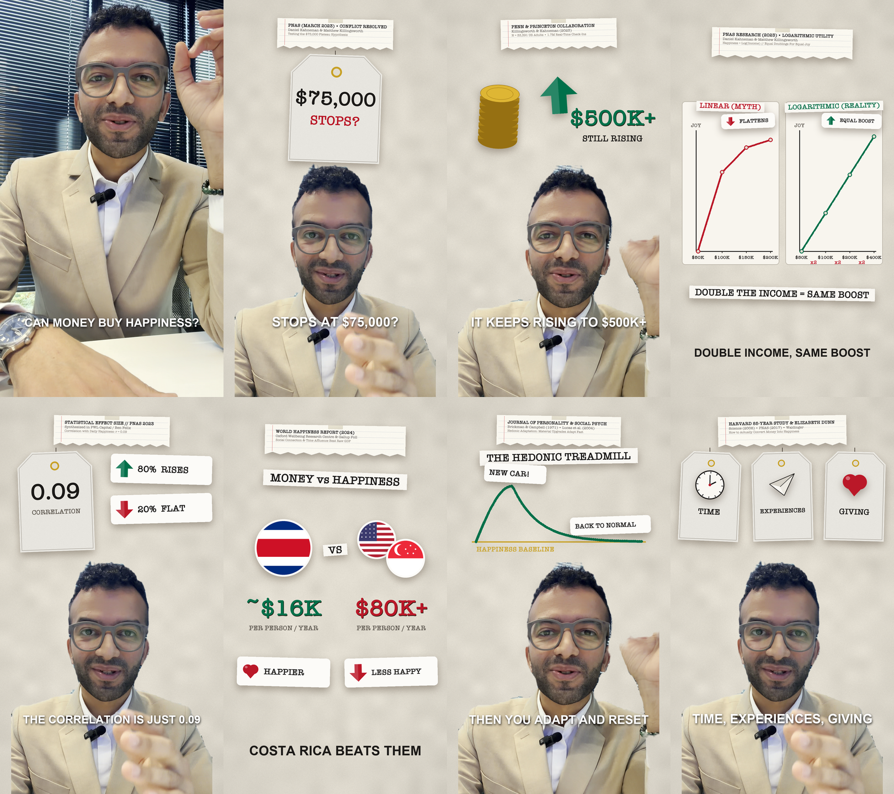
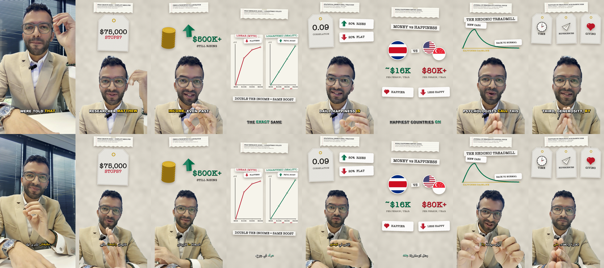
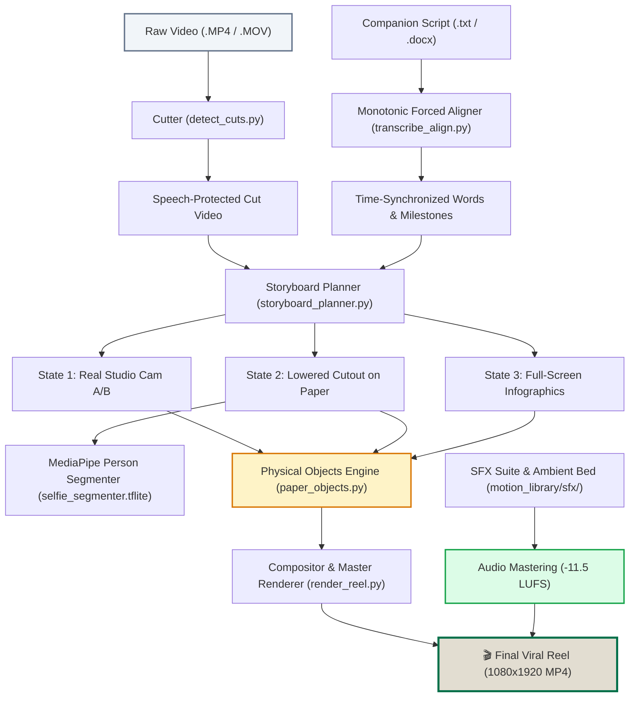

<div align="center">

# 🎬 edit-reel
### Autonomous AI Video Editor for Instagram Reels & TikTok
**Signature Tactile "Paper & Objects" Editorial Aesthetic for Agentic AI**

[](https://opensource.org/licenses/MIT)
[](https://www.python.org/downloads/)
[](https://developers.google.com/mediapipe)
[](https://ffmpeg.org/)
[](https://github.com/MMhaidra/edit-reel)
[](https://claude.ai)
[](https://cursor.com)

<p align="center">
  <a href="#-quickstart-30-seconds">Quickstart</a> •
  <a href="#-the-signature-paper--objects-aesthetic">Aesthetic Engine</a> •
  <a href="#-agentic-ide-integrations">Agentic Integrations</a> •
  <a href="#-pipeline-architecture">Architecture</a> •
  <a href="#-showcase-gallery">Showcase</a> •
  <a href="#-audio-mastering-suite">Audio Suite</a>
</p>

---

</div>

<p align="center">
  
</p>

## 💡 What is `edit-reel`?

`edit-reel` is an **autonomous, zero-interaction editorial pipeline** that transforms raw smartphone talking-head footage into **viral, production-grade 9:16 vertical reels** for Instagram and TikTok.

Unlike generic AI video generators that plaster cheap neon subtitles, floating pastel web-cards, or hazard caution tape over footage, `edit-reel` is built upon the **signature editorial aesthetic** of elite educational and quantitative creators:
- 📜 **Tactile warm paper canvas** (`#E2DDD1`) with subtle natural texture.
- 🏷️ **Hanging cream price tags** with gold brass eyelets and physics-based pendulum sway.
- 💵 **Animated odometer money counters** (rolling smoothly from `$0` $\rightarrow$ `$75,000`).
- 🪙 **3D coin stacks and dimensional arrows** for financial and macroeconomic trends.
- 📓 **Academic notebook cutoffs** (ruled lines, red margins, torn edge, Scotch tape) for peer-reviewed citations.
- 📈 **Parallel comparative plots** (e.g. *Linear Myth* vs. *Logarithmic Reality*).
- 🎙️ **-11.5 LUFS vocal mastering chain** with adaptive noise suppression, ambient bed ducking, and synchronized motion micro-SFX.

---

## 📸 Showcase Gallery

Below is a contact sheet of all 8 scenes rendered in both **English** (*Quant and the Physicist*) and **Moroccan Darija** (*الدارجة المغربية بالحروف العربية*):

<p align="center">
  
</p>

| Scene | Hook / Concept | Visual State | Physical Primitives | Audio Milestone |
|:---:|:---|:---:|:---|:---:|
| **1** | *"Money doesn't buy happiness..."* | Real Studio Footage | Direct Camera A/B + Punch-in Zoom | Crisp Voice + Ambient Bed |
| **2** | *"...past $75,000/year"* | Lowered Cutout on Paper | Hanging Tag on String + Rolling Odometer | Clean Pop + Cash Chime |
| **3** | *"Every rise has diminishing returns"* | Lowered Cutout on Paper | 3D Coin Stack + Forest-Green Up-Arrow | Paper Turn SFX |
| **4** | *"Logarithmic Reality"* | Full-Screen Infographic | Dual Side-by-Side Parallel Graphs | Subtle Whoosh |
| **5** | *Correlation vs. Autonomy* | Lowered Cutout on Paper | Ruled Index Card + Red Margin Line | Tech Tick |
| **6** | *Global Happiness Report* | Full-Screen Infographic | Circular Country Flag Badges + Rankings | Subtle Whoosh |
| **7** | *Hedonic Adaptation* | Lowered Cutout on Paper | Split Bar Chart + Scotch Tape Note | Tech Tick |
| **8** | *Three True Wealth Pillars* | Lowered Cutout on Paper | Triple Rounded Icon Chips (Autonomy / Generosity) | Clean Pop + Outro Bed |

---

## ⚡ Quickstart (30 Seconds)

### Option A: One-Line Universal Install (Antigravity, Claude Code, Cursor)

```bash
curl -fsSL https://raw.githubusercontent.com/MMhaidra/edit-reel/main/install.sh | bash
```

The script automatically:
1. Configures Python virtual environment `.venv`.
2. Installs high-speed vision & speech dependencies (`pillow`, `numpy`, `opencv`, `mediapipe`, `faster-whisper`).
3. Links the skill into **Google Antigravity** (`~/.gemini/config/skills/edit-reel`) and **Claude Code** (`~/.claude/skills/edit-reel`).

### Option B: Manual Installation

```bash
# 1. Clone repository
git clone https://github.com/MMhaidra/edit-reel.git
cd edit-reel

# 2. Setup virtual environment
python3 -m venv .venv
source .venv/bin/activate
pip install -r requirements.txt

# 3. Ensure ffmpeg is installed
# macOS:
brew install ffmpeg
# Ubuntu / Debian:
sudo apt-get install -y ffmpeg
```

---

## 🤖 Agentic IDE Integrations

`edit-reel` is designed from the ground up to be orchestrated by modern autonomous agentic coding environments:

````carousel
```markdown
<!-- slide: Google Antigravity -->
### 🪐 Google Antigravity
The skill is located at:
`~/.gemini/config/skills/edit-reel/SKILL.md`

Simply trigger in your chat:
> `/edit-reel english`
> `/edit-reel darija`

Antigravity will autonomously inspect your raw footage folder (`~/Desktop/projects/reels_IG/`),
match companion scripts, excise false starts, generate physical graphics, and deliver the finished MP4.
```
<!-- slide: Claude Code -->
```markdown
### 🟠 Claude Code (CLI)
The repository includes `CLAUDE.md` and links directly to `~/.claude/skills/edit-reel`.

In your terminal:
```bash
claude
> "Run edit-reel pipeline on my raw video in ~/Desktop/projects/reels_IG"
```
Claude Code reads `CLAUDE.md`, tracks pipeline progress, and compiles the reel.
```
<!-- slide: Cursor & Windsurf -->
```markdown
### ⚡ Cursor & Windsurf
The repository includes `.cursorrules` and `.windsurfrules`.

Open the project in Cursor and prompt Composer / Chat:
> "Run pipeline.py on C7BAE170.MP4 and generate the full contact sheet preview."
```
<!-- slide: Standalone Python CLI -->
```bash
### 🐍 Standalone Python CLI
Run directly from your terminal without any AI assistant:

# Process full video with companion script:
.venv/bin/python3 scripts/pipeline.py \
  -i ~/Desktop/projects/reels_IG/raw_footage.MP4 \
  -s ~/Desktop/projects/reels_IG/script.txt \
  -o ~/Desktop/projects/reels_IG/edited_output \
  --lang en

# Generate instant scene stills and contact sheet:
.venv/bin/python3 scripts/preview_reel_stills.py /tmp/reel_previews
```
````

---

## 🎨 The Signature "Paper & Objects" Aesthetic

```
┌─────────────────────────────────────────────────────────────┐
│ 3-STATE ALTERNATING RHYTHM                                   │
├─────────────────────────────────────────────────────────────┤
│ State 1: REAL STUDIO (Camera A/B)                           │
│   • Authentic room background preserved for hook & pauses   │
│   • 1.04x punch-in zooms on sentence transitions            │
│                                                             │
│ State 2: LOWERED CUTOUT SPEAKER + PHYSICAL OBJECTS          │
│   • MediaPipe AI segmentation (selfie_segmenter.tflite)     │
│   • Speaker cleanly seated on warm paper (y = 800..1920)    │
│   • Upper half displays hanging tags, counters, coin stacks │
│                                                             │
│ State 3: FULL-SCREEN INFOGRAPHIC                            │
│   • Side-by-side comparative plots (Linear vs Log)          │
│   • Academic notebook cutoffs with ruled lines & tape       │
└─────────────────────────────────────────────────────────────┘
```

### 1. Tangible Physical Objects (Zero Generic Web-Cards)
- **Hanging Price Tags on Strings**: Cream cards with angled corners, inner stroke border, and gold metal eyelet hanging from a string. Includes natural pendulum micro-sway upon entry.
- **Dynamic Loading Money**: Monetary milestones animate as rolling odometer counters (e.g. `$0` $\rightarrow$ `$75,000` before stamping crimson `STOPS?`).
- **3D Coin Stacks**: Multi-tier gold coin stacks with rim bevels, accompanied by forest-green (`#00704A`) up-arrows and crimson (`#BA1828`) down-arrows.
- **Academic Notebook Cutoffs**: Authentic pinned notebook paper slips with faint ruled blue-gray lines (`#CBD5E1`), red vertical margin line (`#F87171`), torn bottom edge, and semi-transparent top Scotch tape. Positioned lower down (`y = 165` on speaker scenes, `y = 210` on full-screen scenes) to safely clear mobile camera cutouts and Instagram status bars.
- **Clean Visual Accents**: Rounded white label chips (`border-radius: 18px`) with high-res vector icons and organic ink sketches.

### 2. Speech-Protected Cutting + Anti-Arm-Reach Cutoff
- `detect_cuts.py` leverages `faster-whisper` (`word_timestamps=True`) to pinpoint speech boundaries at millisecond resolution.
- Automatically excises long dead-air pauses, throat clears, stumbles, and repeated takes.
- **Anti-Arm-Reach Cutoff**: Freezes or trims at the calm, smiling frame following the final word, eliminating the awkward reach to switch off the camera.

---

## 🎧 Audio Mastering Suite

Every video rendered by `edit-reel` passes through a broadcast-grade audio pipeline:

```
Raw Microphone Audio
        │
        ▼
FFT Spectral Denoiser (afftdn=nr=24:nf=-48:tn=1)
        │
        ▼
Highpass Filter (85 Hz cutoff)
        │
        ▼
Downward Expander Gate (agate, eliminates room hiss)
        │
        ▼
Studio Vocal Compressor (attack=15ms, release=100ms)
        │
        ▼
Broadcast Loudness Normalizer (loudnorm -> -11.5 LUFS)
        │
        ▼
Ambient Music Bed Ducking (850 Hz low-pass @ volume 0.045)
        │
        ▼
Keyframe-Locked Micro-SFX (paper turns, pops, chimes @ volume 0.04)
        │
        ▼
Final Mastered Multi-Track Audio (.MP4)
```

---

## 🏗️ Pipeline Architecture



---

## 🌐 Multi-Language Support

| Language | Target Account | Subtitle Typography | Editorial Convention |
|:---|:---|:---|:---|
| **English** | *Quant and the Physicist* | Bold Sans-Serif (`#FFFFFF` with `#000000` shadow) | Rigorous quant finance, macroeconomic formulas, LaTeX math, and citations |
| **Moroccan Darija** | *الدارجة المغربية بالحروف العربية* | Bold Arabic Naskh (`Al Bayan` / `Geeza Pro`) | Phonetic Darija transcription while **strictly keeping academic paper titles in English** (e.g. `PNAS 2023`, `Harvard Study`) |

---

## 📂 Repository Structure

```text
edit-reel/
├── SKILL.md                          # Antigravity & Claude Code skill definition
├── README.md                         # Public documentation & showcase
├── LICENSE                           # MIT License
├── requirements.txt                  # Python dependencies
├── pyproject.toml                    # Package metadata & CLI entry points
├── install.sh                        # Universal 1-line installer
├── CLAUDE.md                         # Claude Code developer guide
├── .cursorrules                      # Cursor / Windsurf prompt rules
├── .gitignore                        # Git ignore rules (protects outputs & keys)
├── credit_ledger.example.json        # Template for API token & cost tracking
│
├── assets/                           # Showcase imagery & contact sheets
│   ├── showcase_montage.png
│   └── contact_sheet_v10.png
│
├── models/                           # Bundled edge AI vision models
│   ├── selfie_segmenter.tflite       # Fast 244KB person segmentation model
│   └── selfie_multiclass.tflite     # High-precision multiclass model
│
├── motion_library/                   # Tangible physical objects & styling
│   ├── paper_objects.py              # Canonical objects (tags, odometers, coins, notebooks)
│   ├── renderers.py                  # Motion renderers & canvas drawing
│   ├── palette.py                    # Editorial color system (#E2DDD1, #00704A, #BA1828)
│   ├── catalog.py                    # Metadata & object definitions
│   ├── icons/                        # Over 150+ vector icons across science, tech & finance
│   ├── broll/                        # Curated ambient B-roll textures
│   └── sfx/                          # Mastered sound effects (pops, paper turns, chimes)
│
├── references/                       # Safe-zone specs & phonetic dictionaries
│   ├── safe_zone_layout.md           # 9:16 mobile safe zone boundaries
│   ├── animation_catalog.md          # Visual primitives reference
│   └── darija_transcription.md       # Phonetic Moroccan Darija dictionary
│
├── scripts/                          # Execution pipeline
│   ├── pipeline.py                   # Master end-to-end pipeline runner
│   ├── render_reel.py                # Core video renderer & audio mixer
│   ├── detect_cuts.py                # Speech-protected silence & stumble trimmer
│   ├── transcribe_align.py           # Whisper forced aligner
│   ├── storyboard_planner.py         # 3-state scene scheduler
│   ├── preview_reel_stills.py        # Scene still & contact sheet previewer
│   └── progress_tracker.py           # Real-time terminal progress logger
│
└── templates/
    └── config.json                   # Production defaults
```

---

## 🤝 Contributing

Contributions, feature suggestions, and new physical motion primitives are welcome!
1. Fork the Project (`https://github.com/MMhaidra/edit-reel/fork`).
2. Create your Feature Branch (`git checkout -b feature/AmazingPrimitive`).
3. Commit your Changes (`git commit -m 'feat: Add animated bar chart race object'`).
4. Push to the Branch (`git push origin feature/AmazingPrimitive`).
5. Open a Pull Request.

---

## 📜 License

Distributed under the **MIT License**. See [`LICENSE`](LICENSE) for more information.

---

<div align="center">
  <b>Built with care by <a href="https://github.com/MMhaidra">Mohammed Mhaidra (@MMhaidra)</a></b><br>
  <i>Quant ∩ Physicist</i>
</div>
