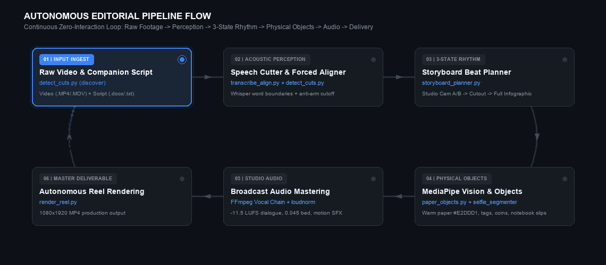
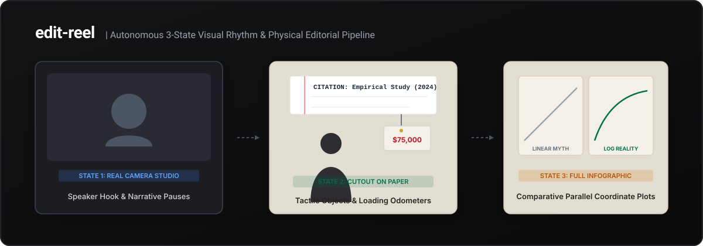

<div align="center">

# edit-reel
### Autonomous AI Video Editor for Instagram Reels and TikTok
**Signature Tactile "Paper and Objects" Editorial Aesthetic for Agentic AI**

<p align="center">
  <b>English</b> |
  <a href="#multilingual-support">Español</a> |
  <a href="#multilingual-support">العربية</a> |
  <a href="#multilingual-support">中文</a> |
  <a href="#multilingual-support">Français</a> |
  <a href="#multilingual-support">Deutsch</a> |
  <a href="#multilingual-support">Português</a> |
  <a href="#multilingual-support">日本語</a>
</p>

[](https://github.com/MMhaidra/edit-reel/releases/latest)
[](https://github.com/MMhaidra/edit-reel#packages)
[](https://opensource.org/licenses/MIT)
[](https://www.python.org/downloads/)
[](https://developers.google.com/mediapipe)
[](https://ffmpeg.org/)
[](https://github.com/MMhaidra/edit-reel)
[](https://claude.ai)
[](https://cursor.com)

<p align="center">
  <a href="#problem-and-solution">Problem and Solution</a> |
  <a href="#quickstart-30-seconds">Quickstart</a> |
  <a href="#agentic-install">Agentic Install</a> |
  <a href="#feature-matrix">Feature Matrix</a> |
  <a href="#releases">Releases</a> |
  <a href="#packages">Packages</a> |
  <a href="#aesthetic-engine">Aesthetic Engine</a> |
  <a href="#multilingual-support">Multilingual Support</a> |
  <a href="#universal-scene-blueprint">Scene Blueprint</a> |
  <a href="#audio-mastering-suite">Audio Suite</a>
</p>

---

</div>

<p align="center">
  
</p>

## Problem and Solution

Vertical short-form video (Instagram Reels, TikTok, YouTube Shorts) commands hundreds of billions of daily impressions worldwide. However, producing compelling educational, technical, scientific, or business talking-head reels by hand requires hours of manual rotoscoping, keyframing, and audio mastering.

Existing automated tools generate generic videos cluttered with neon subtitle boxes, floating pastel web-cards, or hazard caution tape that look artificial and trigger immediate viewer swipe-away.

**edit-reel** introduces an autonomous, zero-interaction editorial pipeline based on the tactile **"Paper and Objects"** aesthetic:
- **Warm Textured Canvas**: Natural cream paper backdrop (`#E2DDD1`) with organic paper grain.
- **Tangible Physical Primitives**: Hanging cream price tags with brass eyelets, 3D multi-tier coin stacks, and dimensional arrows.
- **Dynamic Numerical Odometers**: Smooth rolling counters that visually build up to numerical milestones before stamping a conclusion.
- **Academic Notebook Cutoffs**: Authentic ruled notebook slips with red margin lines, torn bottom edges, and Scotch tape for peer-reviewed citations.
- **Parallel Coordinate Plots**: Clear side-by-side comparative graphs (such as Linear Myth vs. Logarithmic Reality).
- **Speech-Protected Trimming**: Millisecond-accurate word-boundary preservation with automatic anti-arm-reach tail cutoff.
- **Broadcast Audio Mastering**: -11.5 LUFS mastered dialogue with spectral noise suppression, highpass gating, ambient bed ducking, and motion-locked micro-SFX.

---

## Quickstart (30 Seconds)

### 1. One-Line Universal Install

```bash
curl -fsSL https://raw.githubusercontent.com/MMhaidra/edit-reel/main/install.sh | bash
```

The script configures a virtual environment, installs vision and acoustic alignment dependencies, and symlinks the skill into your agentic IDEs.

### 2. Manual Setup

```bash
git clone https://github.com/MMhaidra/edit-reel.git
cd edit-reel

python3 -m venv .venv
source .venv/bin/activate
pip install -r requirements.txt

# Ensure FFmpeg is available
# macOS:
brew install ffmpeg
# Ubuntu / Debian:
sudo apt-get install -y ffmpeg
```

### 3. Run Pipeline on Video

```bash
python scripts/pipeline.py \
  -i ~/Desktop/projects/reels_IG/raw_footage.mp4 \
  -s ~/Desktop/projects/reels_IG/script.docx \
  -o ~/Desktop/projects/reels_IG/edited_output \
  --lang en
```

### 4. Preview Scene Stills

```bash
python scripts/preview_reel_stills.py /tmp/reel_previews
```

---

## Agentic Install

edit-reel is natively structured for autonomous AI coding agents:

### Install Prompt for AI Agents
Paste this single line into **Claude Code**, **ChatGPT Desktop**, or **Cursor**:

```text
Install the /edit-reel skill globally from https://github.com/MMhaidra/edit-reel
```

### Google Antigravity
The skill is defined in `SKILL.md` and registered at `~/.gemini/config/skills/edit-reel/`.

Trigger in conversation:
```text
/edit-reel en
/edit-reel es
/edit-reel ar
```
Antigravity scans your recordings directory (`~/Desktop/projects/reels_IG/`), matches companion scripts, trims dead air, generates physical graphics, masters audio, and delivers the finished MP4 with zero mid-process interruptions.

### Claude Code
The repository provides [`CLAUDE.md`](CLAUDE.md) for terminal execution:
```bash
claude
> "Run edit-reel pipeline on my raw video in ~/Desktop/projects/reels_IG"
```

### Cursor and Windsurf
The repository includes [`.cursorrules`](.cursorrules) configuring code style, safe margins, and testing commands.

---

## Feature Matrix

| Feature | edit-reel | Generic AI Editors | Manual Video Editing |
|:---|:---:|:---:|:---:|
| **Zero User Interaction During Run** | Yes | No (requires manual prompts) | No (hours of manual labor) |
| **Visual Aesthetic** | Tactile Paper and Physical Objects | Neon web-cards / generic templates | Custom (labor-intensive) |
| **Speaker Isolation** | MediaPipe AI (selfie_segmenter) | Chromakey or None | Manual Rotoscoping / Masking |
| **Academic Notebook Citations** | Ruled slips with Scotch tape | Plain text boxes | Manual graphic design |
| **Rolling Numerical Odometers** | Physics-based ease counters | Static text | After Effects expression rigging |
| **Speech-Protected Trimming** | Whisper word-level boundary locks | Hard silence decibel cuts | Manual waveform slicing |
| **Anti-Arm-Reach Cutoff** | Automatic post-speech hold | None (speaker reaches to lens) | Manual clip trimming |
| **Broadcast Audio Mastering** | -11.5 LUFS vocal chain + ambient bed | Raw microphone audio | Multi-plugin DAW mastering |
| **Multilingual Support** | 12+ languages (Latin, RTL, CJK) | English only | Dependent on editor |
| **Local-First Execution** | Yes (runs on your hardware) | Cloud SaaS / Token meters | Yes |

---

## Releases

Official production releases and downloadable archives:

- **Latest Stable Release**: [v1.0.0](https://github.com/MMhaidra/edit-reel/releases/tag/v1.0.0)
- **Source Code (tar.gz)**: [edit-reel-1.0.0.tar.gz](https://github.com/MMhaidra/edit-reel/archive/refs/tags/v1.0.0.tar.gz)
- **Source Code (zip)**: [edit-reel-1.0.0.zip](https://github.com/MMhaidra/edit-reel/archive/refs/tags/v1.0.0.zip)

To download and extract the release:
```bash
curl -fsSL https://github.com/MMhaidra/edit-reel/archive/refs/tags/v1.0.0.tar.gz | tar -xz
cd edit-reel-1.0.0
```

---

## Packages

### Direct Install via pip (GitHub)
```bash
pip install git+https://github.com/MMhaidra/edit-reel.git
```

### Editable Developer Install
```bash
git clone https://github.com/MMhaidra/edit-reel.git
cd edit-reel
pip install -e .
```

After installation, the CLI command `edit-reel` is globally available:
```bash
edit-reel -i raw_video.mp4 -o ./output --lang en
```

---

## Universal Scene Blueprint

The rendering engine follows an 8-scene editorial blueprint designed to maintain engagement across 45-to-90 second reels:

| Scene | Editorial Purpose | Visual State | Graphic Primitives | Audio Milestone |
|:---:|:---|:---:|:---|:---:|
| **1** | Problem Statement / Direct Hook | Real Camera Studio | 1.04x camera punch-in on alternating sentences | Crisp voice, ambient bed introduction |
| **2** | Critical Number / Pivot Metric | Lowered Cutout on Paper | Hanging cream tag with string and rolling odometer | Clean pop, cash chime SFX |
| **3** | Acceleration / Upward Trajectory | Lowered Cutout on Paper | 3D coin stack, dimensional directional arrow | Paper turn SFX |
| **4** | Comparative Breakdown (Myth vs. Reality) | Full-Screen Infographic | Dual parallel coordinate plots | Subtle whoosh SFX |
| **5** | Empirical Evidence / Study Citation | Lowered Cutout on Paper | Ruled notebook paper cutoff with Scotch tape | Tech tick SFX |
| **6** | Global Context / Entity Rankings | Full-Screen Infographic | Circular entity badges and distribution ranks | Subtle whoosh SFX |
| **7** | Counter-Intuitive Truth / Metric Contrast | Lowered Cutout on Paper | Split bar comparison, contrast cards | Tech tick SFX |
| **8** | Strategic Takeaway / Actionable Synthesis | Lowered Cutout on Paper | Triple rounded icon chips and takeaway card | Clean pop, outro bed |

---

## Multilingual Support

edit-reel provides native speech-protected transcription, acoustic alignment, and typographic rendering across worldwide languages:

| Language | ISO Code | Script Family | Subtitle Typography | Ground-Truth Citation Handling |
|:---|:---:|:---:|:---|:---|
| **English** | `en` | Latin | Bold Sans-Serif (`#FFFFFF` with `#000000` shadow) | Technical spelling and formulas preserved |
| **Spanish** | `es` | Latin | Bold Sans-Serif | Academic titles and journal citations preserved |
| **Mandarin Chinese** | `zh` | Simplified / Traditional | PingFang SC / Noto Sans CJK | Automatic CJK character tokenization |
| **Hindi** | `hi` | Devanagari | Devanagari MT / Noto Sans Devanagari | Conjunct ligature and matra support |
| **Arabic** | `ar` | Arabic (RTL) | Al Bayan / Geeza Pro / Naskh | Monotonic right-to-left word highlighting |
| **French** | `fr` | Latin | Bold Sans-Serif | Accent-preserved phonetics |
| **Portuguese** | `pt` | Latin | Bold Sans-Serif | Brazilian and European Portuguese phonetics |
| **German** | `de` | Latin | Bold Sans-Serif | Compound noun protection during speech cuts |
| **Japanese** | `ja` | Kanji / Kana | Hiragino Sans / Noto Sans JP | Boundary-aware acoustic alignment |
| **Italian** | `it` | Latin | Bold Sans-Serif | Latin typographic layout |
| **Russian** | `ru` | Cyrillic | Arial Bold / Helvetica Cyrillic | Cyrillic character set support |
| **Korean** | `ko` | Hangul | AppleGothic / Noto Sans KR | Syllable-block acoustic synchronization |
| **Regional Dialects** | `ary`, `darija` | Arabic / Arabizi | Naskh / Latin | Phonetic Darija alignment with English citations |

Run with your target language:
```bash
python scripts/pipeline.py -i video.mp4 --lang es
python scripts/pipeline.py -i video.mp4 --lang zh
python scripts/pipeline.py -i video.mp4 --lang ar
```

---

## Aesthetic Engine

```text
3-STATE ALTERNATING VISUAL RHYTHM
-------------------------------------------------------------
State 1: REAL CAMERA STUDIO (Camera A/B)
  - Authentic studio background preserved for hook and pauses
  - 1.04x punch-in zooms on sentence transitions for retention

State 2: LOWERED CUTOUT SPEAKER + PHYSICAL OBJECTS
  - MediaPipe AI segmentation (selfie_segmenter.tflite)
  - Speaker positioned on warm paper canvas (y = 800..1920)
  - Upper canvas displays hanging tags, counters, and coin stacks

State 3: FULL-SCREEN INFOGRAPHIC
  - Side-by-side comparative plots (Linear vs. Logarithmic)
  - Academic notebook cutoffs with ruled lines and tape
```

### 1. Tangible Physical Objects
- **Hanging Price Tags**: Cream cards with angled corners, inner stroke border, and gold metal eyelet hanging from a string. Includes physics-based pendulum sway upon entry.
- **Dynamic Loading Numbers**: Numerical milestones animate as rolling odometer counters.
- **3D Coin Stacks**: Multi-tier gold coin stacks with rim bevels, accompanied by green (`#00704A`) up-arrows and red (`#BA1828`) down-arrows.
- **Academic Notebook Cutoffs**: Authentic pinned notebook paper slips with ruled blue-gray lines (`#CBD5E1`), red vertical margin lines (`#F87171`), torn bottom edges, and semi-transparent top Scotch tape. Positioned lower down (`y = 165` on speaker scenes, `y = 210` on full-screen scenes) to safely clear mobile camera cutouts and platform status bars.
- **Vector Icon Chips**: Rounded white label chips (`border-radius: 18px`) with high-resolution vector icons.

### 2. Speech-Protected Trimming and Anti-Arm-Reach Cutoff
- `detect_cuts.py` leverages Faster-Whisper with word-level timestamps to protect every valid spoken syllable.
- Automatically removes dead-air pauses, throat clears, stumbles, and repeated takes.
- **Anti-Arm-Reach Cutoff**: Trims cleanly at the calm, smiling frame following the final word, eliminating the motion of the speaker reaching forward to turn off the camera.

---

## Audio Mastering Suite

Every video rendered by edit-reel passes through an automated broadcast audio mastering chain:

```text
Raw Microphone Audio
        |
        v
FFT Spectral Denoiser (afftdn=nr=24:nf=-48:tn=1)
        |
        v
Highpass Filter (85 Hz cutoff)
        |
        v
Downward Expander Gate (agate, eliminates room hiss)
        |
        v
Studio Vocal Compressor (attack=15ms, release=100ms)
        |
        v
Broadcast Loudness Normalizer (loudnorm -> -11.5 LUFS)
        |
        v
Ambient Music Bed Ducking (850 Hz low-pass at volume 0.045)
        |
        v
Keyframe-Locked Micro-SFX (paper turns, pops, chimes at volume 0.04)
        |
        v
Final Mastered Multi-Track Audio (.MP4)
```

---

## Pipeline Architecture

The end-to-end autonomous pipeline continuously executes through six discrete stages visualized in the looping workflow flowchart at the top:

| Stage | Module | Key Transformation |
|:---:|:---|:---|
| **01** | `detect_cuts.py` | Ingests raw video footage (.mp4/.mov) and companion script (.docx/.txt) |
| **02** | `transcribe_align.py` | Extracts Whisper millisecond word timestamps and applies acoustic silence/stumble trimming |
| **03** | `storyboard_planner.py` | Synthesizes an 8-scene beat map alternating between Studio, Cutout, and Infographic |
| **04** | `paper_objects.py` | Isolates speaker with MediaPipe and composites hanging tags, odometers, and notebook citations |
| **05** | `FFmpeg Vocal Chain` | Applies adaptive spectral denoising, 85Hz highpass gate, -11.5 LUFS loudness, and motion SFX |
| **06** | `render_reel.py` | Exports the production-ready 1080x1920 9:16 vertical reel autonomously |

<p align="center">
  
</p>

---

## Customization (Make It Yours)

Brand styling, color palettes, and audio parameters can be customized via `templates/config.json`:

```json
{
  "canvas": {
    "paper_color": "#E2DDD1",
    "ink_color": "#262320",
    "accent_green": "#00704A",
    "accent_red": "#BA1828"
  },
  "audio": {
    "target_lufs": -11.5,
    "bgm_volume": 0.045,
    "sfx_volume": 0.040,
    "bgm_lowpass_hz": 850
  },
  "safe_zones": {
    "speaker_y": 800,
    "notebook_speaker_y": 165,
    "notebook_fullscreen_y": 210,
    "subtitles_y": 1555
  }
}
```

---

## Repository Structure

```text
edit-reel/
├── SKILL.md                          # Antigravity and Claude Code skill definition
├── README.md                         # Public documentation and specifications
├── LICENSE                           # MIT License
├── requirements.txt                  # Python dependencies
├── pyproject.toml                    # Package metadata and CLI entry points
├── install.sh                        # Universal installer script
├── CLAUDE.md                         # Claude Code developer guide
├── .cursorrules                      # Cursor and Windsurf prompt rules
├── .gitignore                        # Git ignore rules
├── credit_ledger.example.json        # Template for API token and cost tracking
│
├── assets/                           # Vector architecture and diagram assets
│   └── architecture.svg
│
├── models/                           # Bundled edge AI vision models
│   ├── selfie_segmenter.tflite       # Fast 244KB person segmentation model
│   └── selfie_multiclass.tflite     # High-precision multiclass model
│
├── motion_library/                   # Tangible physical objects and styling
│   ├── paper_objects.py              # Canonical objects (tags, odometers, coins, notebooks)
│   ├── renderers.py                  # Motion renderers and canvas drawing
│   ├── palette.py                    # Editorial color system (#E2DDD1, #00704A, #BA1828)
│   ├── catalog.py                    # Metadata and object definitions
│   ├── icons/                        # Over 150+ vector icons across science, tech, and finance
│   ├── broll/                        # Curated ambient B-roll textures
│   └── sfx/                          # Mastered sound effects (pops, paper turns, chimes)
│
├── references/                       # Safe-zone specs and phonetic dictionaries
│   ├── safe_zone_layout.md           # 9:16 mobile safe zone boundaries
│   ├── animation_catalog.md          # Visual primitives reference
│   └── darija_transcription.md       # Phonetic Moroccan Darija dictionary
│
├── scripts/                          # Execution pipeline
│   ├── pipeline.py                   # Master end-to-end pipeline runner
│   ├── render_reel.py                # Core video renderer and audio mixer
│   ├── detect_cuts.py                # Speech-protected silence and stumble trimmer
│   ├── transcribe_align.py           # Whisper forced aligner
│   ├── storyboard_planner.py         # 3-state scene scheduler
│   ├── preview_reel_stills.py        # Scene still and contact sheet previewer
│   └── progress_tracker.py           # Real-time terminal progress logger
│
└── templates/
    └── config.json                   # Production defaults
```

---

## Contributing

Contributions, feature requests, and new motion primitives are welcome:
1. Fork the Project (`https://github.com/MMhaidra/edit-reel/fork`).
2. Create your Feature Branch (`git checkout -b feature/NewMotionPrimitive`).
3. Commit your Changes (`git commit -m 'feat: Add animated dual-gauge metric primitive'`).
4. Push to the Branch (`git push origin feature/NewMotionPrimitive`).
5. Open a Pull Request.

---

## License

Distributed under the **MIT License**. See [`LICENSE`](LICENSE) for more information.

---

<div align="center">
  <b>Author: <a href="https://github.com/MMhaidra">Mohammed Mhaidra</a></b>
</div>
